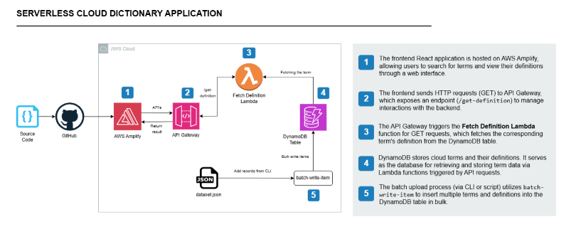

# Serverless Cloud Dictionary

A serverless web app for looking up cloud computing terms. Type a term such as `AWS KMS` and get its definition. Search is case-insensitive.

The React frontend is hosted on **AWS Amplify** and calls an **API Gateway** endpoint backed by a **Lambda** function that reads from **DynamoDB**.

## Architecture



1. **AWS Amplify** hosts the React app and redeploys automatically on every push to GitHub.
2. **API Gateway** exposes a `GET /get-definition` endpoint that the frontend calls.
3. **Lambda** (`lambda/lambda_function.py`) handles the request and looks up the term in DynamoDB.
4. **DynamoDB** stores the terms and their definitions.
5. **`batch-write-item`** loads the dataset from `records/` into DynamoDB through the AWS CLI.

## Project structure

```
.
├── src/                    # React frontend (App.js holds the API URL)
├── public/                 # Static assets
├── lambda/
│   └── lambda_function.py  # Fetch Definition Lambda
├── records/                # DynamoDB seed data (25 items per file)
│   ├── records-1.json
│   └── ...
└── docs/
    ├── architecture.png
    ├── setup-dynamodb.md   # DynamoDB table + data loading guide
    ├── setup-lambda.md     # IAM role + Lambda function guide
    ├── setup-api-gateway.md # REST API, CORS, deployment guide
    └── deploy-frontend.md  # GitHub + Amplify deployment guide
```

## API

`GET /get-definition?term=<term>`

| Status | Response |
|---|---|
| `200` | `{"term": "AWS KMS", "definition": "AWS Key Management Service ..."}` |
| `400` | `{"message": "term is required"}` |
| `404` | `{"message": "Term not found"}` |

The lookup ignores case and extra spaces, so `aws kms`, `Aws Kms` and `AWS KMS` all return the same result.

## Deployment

### Prerequisites

- An AWS account and the [AWS CLI](https://aws.amazon.com/cli/) configured (`aws configure`)
- Node.js (LTS recommended) and npm
- A GitHub repository for this project

### 1. Create the DynamoDB table

For a detailed walkthrough of steps 1–2, including AWS CLI setup, see [docs/setup-dynamodb.md](docs/setup-dynamodb.md).

Create a table with partition key `term` (String). For example:

```bash
aws dynamodb create-table \
  --table-name CloudDefinitions \
  --attribute-definitions AttributeName=term,AttributeType=S \
  --key-schema AttributeName=term,KeyType=HASH \
  --billing-mode PAY_PER_REQUEST
```

### 2. Load the dataset

Each file in `records/` uses the placeholder `<ADD_DYNAMODB_TABLE_NAME_HERE>` on line 2. Replace it with your table name, then load each file:

```bash
for f in records/records-*.json; do
  aws dynamodb batch-write-item --request-items file://$f
done
```

`batch-write-item` accepts at most 25 items per call, so the dataset is split across four files.

### 3. Create the Lambda function

For a detailed walkthrough, including a code explanation and test events, see [docs/setup-lambda.md](docs/setup-lambda.md).

1. Create an IAM role for Lambda with these policies:
   - `AWSLambdaBasicExecutionRole` (CloudWatch logs)
   - `AmazonDynamoDBReadOnlyAccess` (or a custom policy allowing `dynamodb:Scan` on your table)
2. Create a **Python** Lambda function that uses this role, and paste in the code from `lambda/lambda_function.py`.
3. Under **Configuration → Environment variables**, add:

   | Key | Value |
   |---|---|
   | `TABLE_NAME` | your DynamoDB table name |

4. Click **Deploy**.

### 4. Create the API Gateway endpoint

For a detailed walkthrough, including connecting the React app, see [docs/setup-api-gateway.md](docs/setup-api-gateway.md).

1. Create a **REST API**.
2. Add a resource `/get-definition` with a **GET** method that uses **Lambda proxy integration** with your function.
3. Enable **CORS** on the resource.
4. Deploy the API to a stage, such as `dev`, and copy the **Invoke URL**.

Test it:

```bash
curl "https://<api-id>.execute-api.<region>.amazonaws.com/dev/get-definition?term=aws%20kms"
```

### 5. Configure and run the frontend locally

Set `apiUrl` in `src/App.js` to your Invoke URL, then run:

```bash
npm install
npm start
```

The app runs at http://localhost:3000.

### 6. Deploy the frontend with Amplify

For a detailed walkthrough, see [docs/deploy-frontend.md](docs/deploy-frontend.md).

1. Push the project to GitHub.
2. In the **AWS Amplify** console, choose **Create new app → GitHub**, then select the repository and the `main` branch.
3. Accept the detected build settings for Create React App (`npm run build`, output folder `build`).
4. Choose **Save and deploy**. Amplify gives you a URL like `https://main.<app-id>.amplifyapp.com`.

Every push to `main` triggers a new Amplify deployment.

## Tech stack

| Layer | Technology |
|---|---|
| Frontend | React 19, Axios |
| Hosting / CI/CD | AWS Amplify |
| API | Amazon API Gateway (REST) |
| Compute | AWS Lambda (Python, boto3) |
| Database | Amazon DynamoDB |

## Troubleshooting

| Symptom | Cause / fix |
|---|---|
| Clicking **Search** shows nothing | Open the browser console. A `404` means the term isn't in the table, and a `502` usually means the Lambda failed (check its CloudWatch logs). |
| Lambda returns `502` with `KeyError: 'TABLE_NAME'` | The `TABLE_NAME` environment variable isn't set on the function. |
| `AccessDeniedException` in Lambda logs | The Lambda role is missing `dynamodb:Scan` permission. |
| `batch-write-item` fails with `ResourceNotFoundException` | The placeholder in `records/*.json` wasn't replaced with your table name, or the table is in a different region. |
| `dyld: Library not loaded: libllhttp...` when running `npm` | Homebrew's Node is broken. Run `brew reinstall node`, or install Node with `nvm`. |
